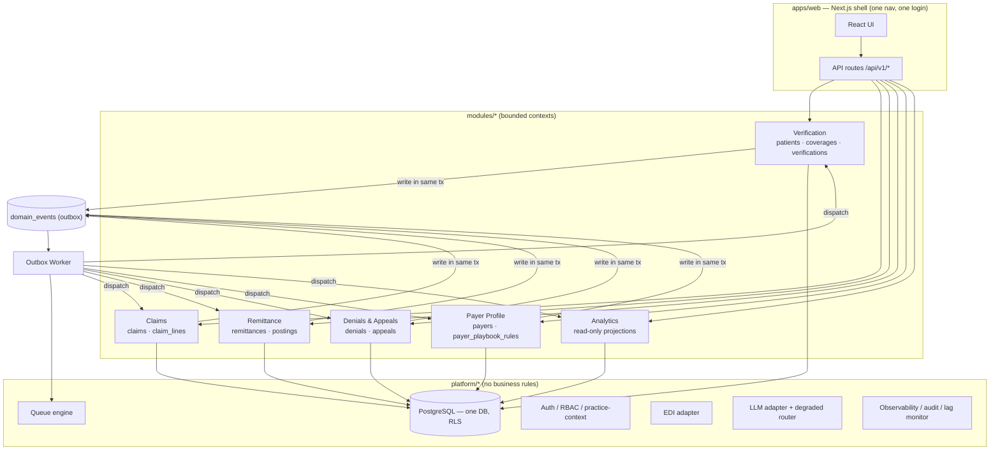

# 02 — Final Module Architecture

*Blueprint doc 2 of 16.*

## The six bounded contexts

Each module owns a slice of the domain, its own tables, its own services, and its own repository.
The **only** wire between modules is a `domain_events` row (doc 05). This is the discipline that
keeps the monolith modular and makes a future service split mechanical
(`ai-revenue-cycle-implementation-roadmap.md` §4; `architecture-risk-review.md` §5).



## Module responsibility matrix

| Module | Owns (tables) | Publishes | Consumes | Key services |
|---|---|---|---|---|
| **Verification** | `patients`, `coverages`, `verifications` | `verification.completed`, `verification.needs_review` | `payer_rule.updated` | `runVerification`, `interpretCard`, `calcCoverage`, `decideVerification` |
| **Claims** | `claims`, `claim_lines` | `claim.created`, `claim.submitted`, `claim.filing_risk` | `verification.completed` | `createClaimFromVerification`, `scrubClaim`, `submitClaim`, `transitionClaim` |
| **Remittance** | `remittances`, `postings` | `remittance.received`, `remittance.posted`, `variance.detected` | `claim.submitted` | `ingestRemittance`, `autoPost`, `manualEob`, `reversePosting`, `reconcile` |
| **Denials & Appeals** | `denials`, `appeals` | `denial.created`, `denial.resolved`, `appeal.created`, `appeal.submitted`, `appeal.outcome.recorded` | `remittance.posted`, `variance.detected` | `triageDenial`, `draftAppeal`, `resolveAppeal` |
| **Payer Profile** | `payers`, `payer_playbook_rules` | `payer_rule.updated` | `appeal.outcome.recorded` | `getPlaybook`, `updateOverturnRate`, `promoteRule` |
| **Analytics** | *(read-only projections)* | — | *all events* | `summary`, `aging`, `denialTrends`, `dollarsRecovered` |

## Module internal shape (identical across all six)

```
modules/<name>/
├── package.json                # @mermaid/<name>
├── src/
│   ├── index.ts                # PUBLIC surface — the only thing apps/web imports
│   ├── types.ts                # module-local types (shared types live in @mermaid/shared)
│   ├── service.ts              # orchestration; the transactional use-cases
│   ├── repository.ts           # ALL SQL for this module's tables (nothing else touches them)
│   ├── engine/                 # pure, deterministic domain functions (ported donor engines)
│   ├── events.ts               # event producers (publish) + subscribers (handle)
│   └── __tests__/*.test.mjs
└── migrations/                 # this module's DDL, namespaced (see doc 15)
```

Rules that make this real:
- **`repository.ts` is the sole SQL surface** for a module's tables. Services call the repository;
  nothing outside the module can (RLS + boundary checker back this up).
- **`engine/` is pure** — no I/O, no DB, deterministic, unit-tested. This is where the ported donor
  logic lives (`calc`, `edi271` parse, `scrubClaim`, `triageDenial`, `era835` parse, `findLeaks`…).
  Every AI/heuristic output carries `confidence` + `explanation` (donor doctrine, roadmap §7).
- **`events.ts`** declares which events the module emits and which it subscribes to; the worker
  routes to the subscribers. No module calls another's `service.ts`.

## Where the donor code lands (port map)

| Donor asset | New home |
|---|---|
| `healthcare-ai-assistant` `lib/insurance/{calc,edi271,connectors,pipeline,analysis,freshness,ocr,decision,summary,cdt,types}` | `modules/verification/{engine,service,types}` (edi271 → `platform/edi` mock adapter) |
| `healthcare-ai-assistant` `lib/agents/{sweep,runtime}` | `modules/verification` sweep + `platform/events` runtime hook |
| `dental-rcm-platform` `engines/core.js` (scrub) | `modules/claims/engine` |
| `dental-rcm-platform` `engines/core.js` (triage, appeal, leaks, insights) | `modules/denials-appeals/engine` + `modules/analytics` |
| `dental-rcm-platform` `engines/era835.js` | `platform/edi` mock adapter (835 parse) |
| `dental-rcm-platform` `services.js` (claim lifecycle) | `modules/claims/service` |
| `dental-rcm-platform` `services.js` (ingest/post/reverse) | `modules/remittance/service` |
| `dental-rcm-platform` `services.js` (rebuildQueue, scoreQueueItem) | `platform/queue` |
| `dental-rcm-platform` `services.js` (analyticsSummary) | `modules/analytics` |
| `dental-rcm-platform` `data/knowledge.js` (CARC/RARC/CDT/playbook) | `modules/payer-profile` (seed data) + `@mermaid/shared` (CDT/CARC reference) |
| both auth stacks | `platform/auth` (unified) |

## Extensibility

New capability = new module (own tables + events) or a new subscriber on an existing event. Because
coupling is events-only, adding e.g. a **Patient Communications** module later (to send estimates
after a human triggers them — doc 11/HITL §3) means subscribing to `verification.completed` and
adding tables, with **zero** edits to existing modules.
