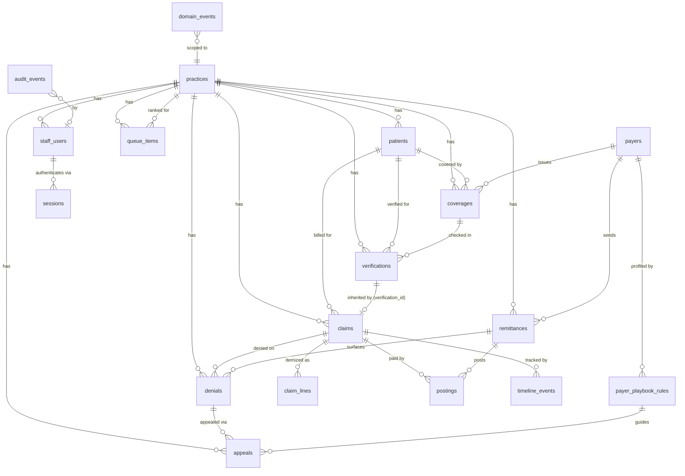

# 03 — Database ER Diagram

*Blueprint doc 3 of 16. One PostgreSQL database. All tables carry `practice_id` and are under RLS
(doc 08) except the tenancy root and outbox bookkeeping. Column types are indicative; the
authoritative DDL is the migration set (doc 15).*

## Entity-relationship diagram

## Table catalog (authoritative column list)

**Legend:** 🔒 = under RLS on `practice_id`. `sv` = JSONB carrying `snapshot_version` (CHECK
`jsonb_has_version`). All PKs are `UUID DEFAULT gen_random_uuid()`; all tables have
`created_at TIMESTAMPTZ`; mutable tables have `updated_at` (trigger `set_updated_at`).

| Table | RLS | Key columns |
|---|---|---|
| `practices` | root | `id`, `name`, `plan`, `status` |
| `staff_users` | 🔒 | `id`, `practice_id`, `email UNIQUE`, `name`, `role`, `password_hash`, `disabled`, `reset_token_hash`, `reset_token_exp` |
| `sessions` | 🔒 | `token_hash PK`, `practice_id`, `user_id`, `csrf`, `expires_at`, `ip`, `created_at` |
| `patients` | 🔒 | `id`, `practice_id`, `chart_id`, `first_name`, `last_name`, `dob`, `UNIQUE(practice_id, chart_id)` |
| `payers` | shared* | `id`, `name`, `edi_payer_id`, `filing_window_days`, `appeal_window_days`, `avg_days_to_pay` |
| `payer_playbook_rules` | shared* | `id`, `payer_id`, `carc_code`, `cdt_code?`, `disposition`, `recommended_action`, `overturn_rate NUMERIC(4,3)`, `sample_size`, `guidance`, `updated_at` |
| `coverages` | 🔒 | `id`, `practice_id`, `patient_id`, `payer_id`, `member_id`, `group_number`, `plan_type`, `effective_date`, `term_date`, `cob_order`, `raw_card_text` (encrypted), `benefit_snapshot sv` |
| `verifications` | 🔒 | `id`, `practice_id`, `patient_id`, `coverage_id`, `status`, `confidence_score NUMERIC(4,3)`, `benefit_snapshot sv`, `planned_procedures sv`, `estimate_insurance_pays`, `estimate_patient_owes`, `valid_until`, `data_source`, `record sv` (full VerificationRecord), `raw_271` (encrypted), `review_decision?` |
| `claims` | 🔒 | `id`, `practice_id`, `patient_id`, `verification_id?`, `coverage_snapshot sv` (immutable), `state`, `provider`, `dos`, `total_charged`, `paid`, `adjusted`, `patient_resp`, `submitted_at?`, `filing_deadline?`, `external_no?`, `notes` |
| `claim_lines` | 🔒 | `id`, `practice_id`, `claim_id`, `cdt_code`, `description`, `tooth_surf_quad`, `fee`, `estimated_insurance_pays`, `paid`, `adj_json`, `patient_resp`, `status` |
| `remittances` | 🔒 | `id`, `practice_id`, `payer_id?`, `trace_number`, `method`, `raw_835` (encrypted), `checksum`, `received_at`, `total_amount`, `exceptions_count`, `status`, `UNIQUE(practice_id, trace_number)` ← idempotency |
| `postings` | 🔒 | `id`, `practice_id`, `remittance_id`, `claim_id`, `paid`, `adjusted`, `patient_resp`, `amounts_json`, `auto_posted`, `reversed_by?`, `reversal_reason?`, `posted_at` |
| `denials` | 🔒 | `id`, `practice_id`, `claim_id`, `claim_line_id?`, `remittance_id?`, `carc_code`, `rarc_code?`, `group_code`, `cdt_code?`, `amount`, `recoverable_value`, `category`, `disposition`, `overturn_score`, `deadline`, `status` |
| `appeals` | 🔒 | `id`, `practice_id`, `denial_id`, `level`, `status`, `playbook_rule_id?`, `letter_text`, `checklist_json`, `submitted_at?`, `outcome`, `recovered`, `submitted_by?`, `outcome_recorded_at?` |
| `timeline_events` | 🔒 | `id`, `practice_id`, `claim_id?`, `patient_id?`, `event_type`, `actor`, `detail sv`, `occurred_at` |
| `queue_items` | 🔒 | `id`, `practice_id`, `kind`, `ref_kind`, `ref_id`, `score`, `score_explain_json`, `state`, `title`, `amount`, `action`, `assigned_to?`, `sla_at?`, `snoozed_until?`, `completed_at?` |
| `domain_events` | 🔒 | `id`, `practice_id`, `event_type`, `aggregate_id`, `payload sv`, `published`, `attempts`, `available_at`, `created_at`, `published_at?` |
| `audit_events` | 🔒 | `id BIGSERIAL`, `practice_id`, `trace_id`, `actor_id?`, `actor_role?`, `action`, `resource`, `resource_id?`, `before_json?`, `after_json?`, `outcome`, `ip`, `created_at` — **append-only** |
| `reconciliation_runs` | 🔒 | `id`, `practice_id`, `ran_at`, `remittances_checked`, `posted_total`, `raw_835_total`, `drift`, `status`, `detail_json` |
| `feature_flags` | 🔒 | `id`, `practice_id?`, `flag`, `enabled`, `updated_at` — per-practice cutover control |

\* **Payers are cross-practice reference data** with a per-practice overlay: the base payer catalog
is shared, but `payer_playbook_rules.overturn_rate`/`sample_size` accumulate per practice **and** in
a platform-wide aggregate (doc 11). Access is read-shared, write-guarded; see doc 08 for how RLS
treats the shared reference tier vs. the tenant tier.

## Indexing (hot paths)

- FK columns all indexed. `claims(practice_id, state)`, `denials(practice_id, status)`,
  `queue_items(practice_id, state, score DESC)`, `verifications(practice_id, status)`,
  `remittances(practice_id, trace_number)` (unique), `domain_events(published, available_at)`
  (partial: `WHERE published = false`), `timeline_events(claim_id, occurred_at)`,
  `audit_events(practice_id, created_at DESC)`, `coverages(patient_id)`,
  `payer_playbook_rules(payer_id, carc_code, cdt_code)`.

## The one relationship that encodes the product thesis

`claims.verification_id` + `claims.coverage_snapshot` — a claim **inherits** the exact snapshot the
estimate used (immutable copy, not a FK to mutable `coverages`). That is what makes
`claim_lines.estimated_insurance_pays` vs `postings.paid` a **computable variance**, which drives
auto-reconciliation and the recovery queue (doc 11, roadmap §2).
