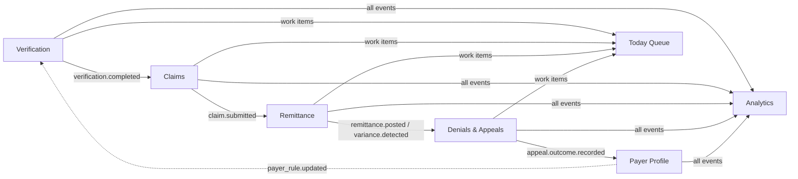

# 05 — Domain Event Architecture

*Blueprint doc 5 of 16. The outbox is the seam between modules. This is the single most important
runtime contract in Mermaid — the feedback loop that is the product thesis runs through it, so it is
built to be durable and monitored, not best-effort (`architecture-risk-review.md` §1.2, §7).*

## Why outbox, not a message broker

A domain event is written to the `domain_events` table **in the same transaction** as the business
write that caused it. Guaranteed consistency (an event can't exist for a rolled-back write, nor
vanish for a committed one) without standing up Kafka/SNS. A worker polls and dispatches. The event
*contract* is transport-independent, so a broker can replace the poller later with no change to
producers/consumers (roadmap §1, §3).

## The envelope

```ts
// @mermaid/shared/events.ts
export interface DomainEvent<T extends object = object> extends Versioned {
  id: string;                 // uuid
  practiceId: PracticeId;     // every event is tenant-scoped
  eventType: EventType;       // the union below
  aggregateId: string;        // claimId / verificationId / denialId …
  payload: T & Versioned;     // versioned, self-describing
  createdAt: string;
}
export type EventType =
  | "verification.completed" | "verification.needs_review"
  | "claim.created" | "claim.submitted" | "claim.filing_risk"
  | "remittance.received" | "remittance.posted" | "variance.detected"
  | "denial.created" | "denial.resolved"
  | "appeal.created" | "appeal.submitted" | "appeal.outcome.recorded"
  | "payer_rule.updated";
```

## Event catalog (producers → consumers → effect)

| Event | Producer | Consumers | Effect |
|---|---|---|---|
| `verification.completed` | Verification | Claims, Analytics, Queue | unlocks claim creation with inherited snapshot |
| `verification.needs_review` | Verification | Queue | routes low-confidence case to a coordinator |
| `claim.created` | Claims | Timeline, Analytics | records claim genesis on the timeline |
| `claim.submitted` | Claims | Remittance, Analytics | starts the filing-deadline clock |
| `claim.filing_risk` | Claims | Queue | flags claims nearing filing deadline |
| `remittance.received` | Remittance | Analytics | 835/EOB arrived (pre-post) |
| `remittance.posted` | Remittance | Claims, Analytics, Queue | updates claim state; triggers variance check |
| `variance.detected` | Remittance | Denials & Appeals, Queue | estimate-vs-actual mismatch beyond threshold |
| `denial.created` | Denials & Appeals | Queue, Payer Profile (read), Analytics | adds to value-ranked recovery queue |
| `denial.resolved` | Denials & Appeals | Analytics, Queue | closes the loop on a denial |
| `appeal.created` | Denials & Appeals | Queue | "submit appeal" work item |
| `appeal.submitted` | Denials & Appeals | Analytics | appeal is with the payer |
| `appeal.outcome.recorded` | Denials & Appeals | **Payer Profile**, Verification (read), Analytics | **updates overturn_rate → sharpens confidence** (the loop) |
| `payer_rule.updated` | Payer Profile | Verification (read), Analytics | new/updated rule available to scoring |



## Producing an event

```ts
// platform/events/publish.ts — called INSIDE the caller's transaction.
export async function publish(tx: Tx, evt: NewDomainEvent): Promise<void> {
  await tx.query(
    `INSERT INTO domain_events (practice_id, event_type, aggregate_id, payload)
     VALUES ($1,$2,$3,$4)`,
    [evt.practiceId, evt.eventType, evt.aggregateId, evt.payload /* versioned */]
  );
}
// Usage inside remittance.service.autoPost():
await withPractice(practiceId, async (tx) => {
  await postingsRepo.insert(tx, posting);
  await publish(tx, { practiceId, eventType: "remittance.posted", aggregateId: claimId,
    payload: { snapshot_version: 1, claimId, paid, adjusted, patientResp } });
}); // one COMMIT → business write + event are atomic
```

## The worker (durable, at-least-once, monitored)

```ts
// platform/events/worker.ts
// Poll unpublished rows, lock a batch skipping locked rows (safe to run N workers),
// dispatch to subscribers, mark published. Retries with backoff via available_at + attempts.
const BATCH = `
  SELECT * FROM domain_events
   WHERE published = false AND available_at <= now()
   ORDER BY created_at
   FOR UPDATE SKIP LOCKED
   LIMIT $1`;
```

- **At-least-once delivery** → every subscriber must be **idempotent** (keyed on `event.id` or a
  natural key). Consumers record processed `event.id`s or use upserts.
- **Horizontal scale:** `FOR UPDATE SKIP LOCKED`, partitioned by `practice_id` hash, lets many
  workers run without double-processing (`architecture-risk-review.md` §2).
- **Retry/backoff:** on handler error, bump `attempts`, set `available_at = now() + backoff(attempts)`;
  after N attempts, park to a dead-letter state and alert.
- **Monitoring (P6, mandatory):** an event-lag metric (oldest `unpublished.created_at`) is alarmed —
  the feedback loop must never stall silently. A stalled worker is a paging incident, not a mystery.

## Ordering & consistency notes

- Events are ordered per aggregate by `created_at`; cross-aggregate ordering is not guaranteed and
  consumers must not assume it.
- Subscribers run in their own transaction; a subscriber failure never rolls back the producer (the
  event is already committed) — it just retries.
- Because delivery is at-least-once and consumers are idempotent, a duplicate dispatch is harmless.
