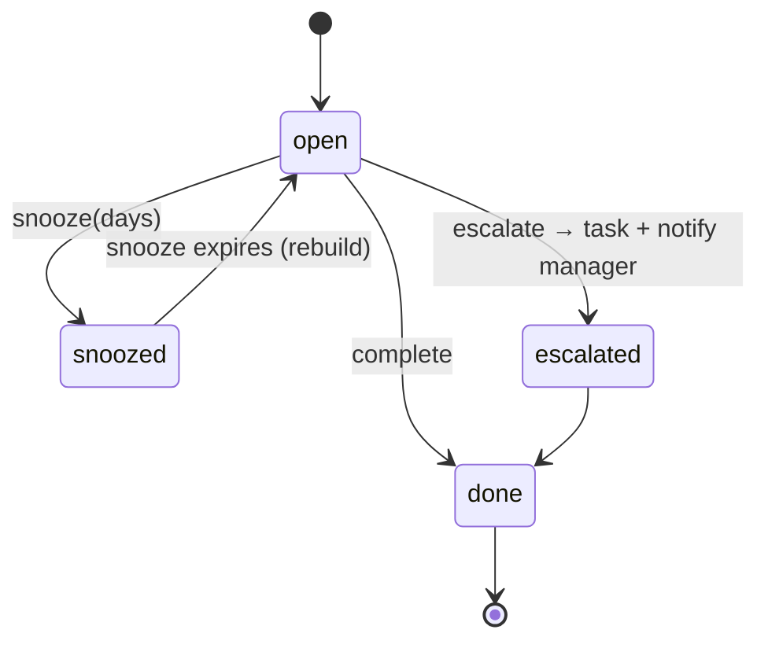

# 07 — Queue Architecture

*Blueprint doc 7 of 16. ONE unified, value-ranked "Today" queue — the single place any staff member
sees what to work on next, spanning both halves of the cycle (`unified-rcm-workflow.mermaid`;
roadmap §5–6; `human-in-the-loop-workflow.pdf` §7). It replaces the two separate queues in the donor
apps.*

## Principle

The queue **ranks by value, humans decide by judgment** (HITL §7). The system computes an
expected-value × urgency × actionability score and orders the work; it never auto-executes the
judgment calls (pursue-vs-write-off, appeal submission, patient conversation) — those are gated (doc
08/11). Ranking is data; the decision stays human above a practice-set threshold.

## One queue, many producers

`queue_items` (doc 03) is fed by **domain-event subscribers**, not by modules writing to it directly.
Each producer maps an event to a work item; the queue engine scores it.

| Queue item `kind` | Fed by event | Owner role | Example title |
|---|---|---|---|
| `verification_review` | `verification.needs_review` | insurance_coordinator | "Review verification — 62% confidence, visit in 22h" |
| `claim_filing_risk` | `claim.filing_risk` | biller | "Claim #123 nears filing deadline (5d)" |
| `posting_exception` | `remittance.posted` (exceptions) | biller | "Posting exception — unmatched remit" |
| `denial` | `denial.created` | biller / office_manager | "Denial CARC 50 — $420, appealable" |
| `appeal` | `appeal.created` | biller | "Submit appeal L1 — CARC 50, $420" |
| `variance` | `variance.detected` | biller | "Paid $180 under estimate on claim #123" |
| `leak` | (analytics scan) | biller | "Unfiled secondary — $95" |

Because producers are event subscribers, adding a new work source = new subscriber, **zero** edits to
existing modules.

## Scoring model (ported + unified from AI Remit `scoreQueueItem`)

```ts
// platform/queue/engine.ts — pure, deterministic, explainable.
score = round( expectedValue × urgency × actionability )

expectedValue =
  kind ∈ {denial, appeal}  ? amount × overturnScore        // recovery odds
                           : amount                          // dollars at stake
urgency =
  deadline passed/today → 3.0 ; ≤5d → 2.5 ; ≤14d → 1.8 ; ≤30d → 1.3 ; else 1.0
  ∪ aging pressure: >60d → ≥1.6 ; >30d → ≥1.25
  ∪ visit proximity (verification items): ≤24h → high
actionability =
  posting_exception 1.3 · denial_correctable 1.25 · status_check 1.1 · else 1.0
```

Every item stores `score_explain_json` — the human-readable "why this is ranked here" (e.g.
`"Expected value $252 = $420 × 60% recovery odds; 5d to deadline — critical"`). Provenance is a
feature (donor doctrine).

## Item lifecycle



- `complete` — records `completed_at`; feeds "done today" metrics.
- `snooze(days)` — hides until `snoozed_until`; the rebuild wakes it.
- `escalate` — creates a task for a manager/owner and notifies (HITL: larger amounts pull in the
  office manager).
- Items are **derived**: a nightly/eventful **rebuild** recomputes open items from current state,
  preserving snoozed/escalated holds so they aren't duplicated (ported `rebuildQueue` semantics).

## Rebuild vs. event-driven

Two complementary paths (both from the donor design, unified):
1. **Event-driven insert** — when `denial.created` etc. fires, a producer inserts/updates the item
   immediately (fresh queue without waiting for a sweep).
2. **Periodic rebuild** — a scheduled sweep re-scores everything (deadlines move daily; a claim that
   was fine yesterday is filing-risk today) and reconciles the set, honoring holds.

## API

```
GET  /api/v1/queue/today            → { items: QueueItem[] (score DESC), doneToday: {n, value} }
POST /api/v1/queue/:id/complete
POST /api/v1/queue/:id/snooze       { days }
POST /api/v1/queue/:id/escalate
```

## What the queue is NOT allowed to do

- It never **auto-completes** a judgment item (appeal, pursue/write-off, patient conversation).
- It never crosses tenants — `queue_items` is under RLS; a rebuild runs per practice.
- It never reads another module's tables to build an item — it consumes events (payloads carry what
  it needs).
