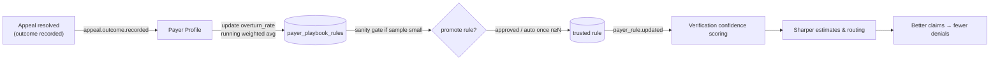

# 11 — Continuous Learning Architecture

*Blueprint doc 11 of 16. The feedback loop is the product thesis — the one differentiator worth
building and testing before anything else (`ai-revenue-cycle-implementation-roadmap.md` §5;
`unified-rcm-workflow.mermaid`; `architecture-risk-review.md` §7). It is "more data engineering than
AI": a transparent, auditable running average, gated by a human sanity check while samples are small
(`human-in-the-loop-workflow.pdf` §9).*

## The loop, end to end



The same `payer_playbook_rules` row is **written by Appeals** (from outcomes) and **read by
Verification** (to score confidence) — that shared "brain" is the whole point of one database.

## Mechanics

### 1. Record the outcome (Denials & Appeals)
When an appeal resolves, `resolveAppeal` writes the outcome and emits `appeal.outcome.recorded` with
`{ payerId, carc, cdt, outcome, recovered }`.

### 2. Update the rule (Payer Profile subscriber) — transparent running average
```ts
// modules/payer-profile — subscriber on appeal.outcome.recorded (idempotent on event.id)
// Weighted running average, NOT a black-box model (roadmap §7.6):
overturn_rate' = (overturn_rate × sample_size + won) / (sample_size + 1)
sample_size'   = sample_size + 1
// won = 1 for outcome ∈ {overturned, partial}, else 0.
```
Every update is visible to staff (the rule row shows `overturn_rate`, `sample_size`, `updated_at`) —
defensible in a sales call, debuggable, auditable.

### 3. Small-sample sanity gate (HITL §9)
A single unusual outcome must not swing a rule that then drives recommendations for every future
patient on that payer.
- While `sample_size < N` (e.g. 5), rule changes are **staged**, not trusted: recommendations still
  use the default CARC prior, and the staged rule surfaces to an `office_manager` / platform-ops
  review before promotion.
- Once `sample_size ≥ N`, updates flow automatically (it's a statistical update, not a judgment call).
- Promotion is an audited action; `payer_rule.updated` fires only for promoted (trusted) rules.

### 4. Sharpen confidence (Verification consumer)
Verification's **confidence score is a transparent heuristic** (roadmap §7.3):
```
confidence = f( dataSourceReliability,     // edi > portal > manual > mock
                fieldCompleteness,          // how much of the 271 was answered
                payerHistoricalAccuracy )   // ← from payer_playbook_rules / payer profile stats
```
When `payer_rule.updated` arrives, Verification refreshes the payer-historical-accuracy term. This is
the front-half learning that neither donor app had — it closes the loop from the back half to the
front.

## Two-tier learning (per-practice + platform-wide)

- **Per-practice** overturn rates capture "how this payer treats *this* practice."
- **Platform aggregate** (across practices, PHI-free — only payer/CARC/outcome counts) captures
  "how this payer behaves generally," used as a prior for new practices with no history yet.
- Both are just counts; the platform aggregate never carries patient data (minimum-necessary, risk
  §4).

## What is deliberately NOT learned (yet)

- No trained ML model in v1. A learned confidence model is a later augmentation, *once the platform
  has generated enough labeled outcomes* (estimate vs. actual) — which the unified schema starts
  producing on day one (`claim_lines.estimated_insurance_pays` vs `postings.paid`). Building a fancy
  pipeline before that volume exists is explicitly rejected (roadmap §7.6).

## Durability & monitoring (risk §1.2 — non-negotiable)

The loop runs through the outbox worker. If it stalls, confidence scores go stale silently — the
worst failure mode because nobody notices. Therefore:
- Event-lag on `appeal.outcome.recorded` → `payer_rule.updated` is **metered and alarmed** (doc 05,
  doc 13).
- The subscriber is idempotent (event.id dedupe) so retries never double-count an outcome.
- A weekly "rule quality" report surfaces rules whose recommendations diverge from recent outcomes —
  the completeness check on the learning itself.
