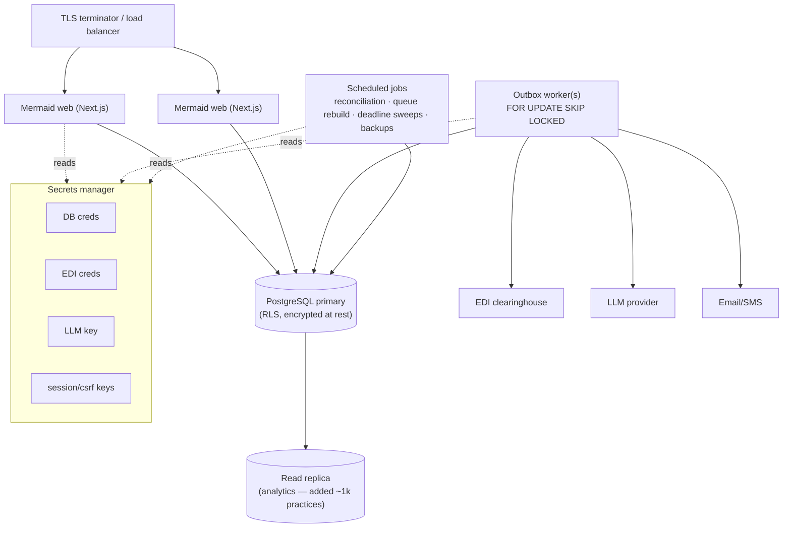

# 12 — Deployment Architecture

*Blueprint doc 12 of 16. How Mermaid runs. A modular monolith deploys as a small number of processes,
not a fleet of services — that's the point of the architecture (roadmap §0).*

## Runtime topology

## Processes (three roles, one codebase)

| Process | Runs | Scale | Notes |
|---|---|---|---|
| **web** | Next.js app + `/api/v1` BFF | N behind LB (stateless) | sessions in DB, so any instance serves any request |
| **worker** | outbox poller + event dispatch | 1 → N (`SKIP LOCKED`, practice-hash partition) | at-least-once; idempotent consumers |
| **jobs** | reconciliation (daily), queue rebuild, deadline notifications, backups | 1 (leader) | schedule via cron/scheduler; unref timers per donor pattern |

All three are the same deployable started with different entrypoints/flags — no separate builds.

## Environments

| Env | DB | EDI | LLM | Purpose |
|---|---|---|---|---|
| **dev** | managed remote Postgres (approved) | `EDI_ADAPTER=mock` | `LLM_PROVIDER=off` | local machine stays light (4GB/SMR constraint) |
| **CI** | throwaway Postgres 16 service | mock | off | migrate + tests + boundaries |
| **staging** | managed Postgres (separate) | vendor sandbox | BAA provider (test) | shadow-mode rehearsal before prod cutovers |
| **prod** | managed Postgres HA | vendor prod | BAA provider | per-practice feature-flagged rollout |

## Configuration & secrets

- All config via env (`.env.example` is the contract). **No secrets in env files in prod** — a real
  secrets manager (per-environment scoped, rotation) holds DB creds, EDI creds, LLM key, session
  keys (risk §3). The app reads them at boot; fail-fast if a required prod secret is missing (donor
  `config/env` doctrine).
- The **app DB role is unprivileged** (`mermaid_app`, RLS-subject); migrations use a separate
  privileged role (`DATABASE_ADMIN_URL`).

## Release & rollback

- **CI gates:** boundaries → typecheck → migrate → tests. No merge without green.
- **Migrations run before app rollout**, forward-only; the app is written to tolerate the additive
  schema of the phase it ships in.
- **Per-practice feature flags** gate every phase's behavior; **shadow mode** for P3/P5 (money).
  Rollback = flip the flag, not restore the DB.
- **Blue/green or rolling** web deploys (stateless). Worker/jobs drain the in-flight event before
  swap.

## Backups & DR

- Managed Postgres automated backups + PITR; periodic logical dump retained off-host (donor Remit had
  timed backups — kept as a belt for self-hosted).
- Documented restore runbook; restore is rehearsed in staging.
- Retention/deletion policy per data type (risk §4) — dental records carry multi-year obligations;
  practices that leave get a defined deletion path.
