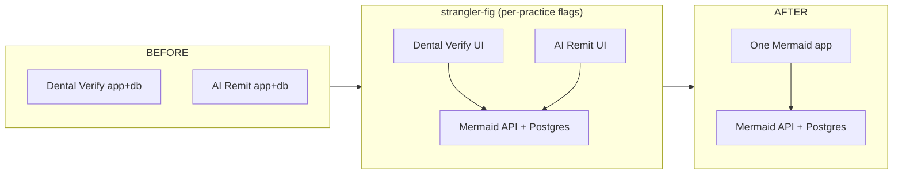

# 15 — Migration Strategy

*Blueprint doc 15 of 16. Two things called "migration": (A) the schema/DDL migration mechanism, and
(B) the strangler-fig program that moves two live apps onto Mermaid. Both here.*

---

## A. Schema migrations (DDL)

**Mechanism (live from P0):** forward-only, numbered SQL files in `platform/db/migrations/NNNN_*.sql`,
applied in order by `migrate.mjs`, recorded with a **checksum**. A file edited after being applied
fails loudly — migrations are immutable; you add a new one.

**The whole pending set is applied in ONE transaction, under `pg_advisory_xact_lock` (DEC-2).**
This replaced "each in its own transaction", and the change was forced by concurrency rather than
chosen for elegance. `pending` is computed by reading `_migrations` and written back only as each
file succeeds, so two runners — two instances booting, a rolling deploy, a person racing CI — both
see the same empty `pending` and both apply it. A file that is DDL-idempotent but also seeds or
backfills (`0014`, `0015`, `0016`) then applies its data change twice, and no checksum catches that
because nothing about the file changed.

A **session-level** `pg_advisory_lock` was implemented first and rejected on evidence: the
deployment's connection string points at a PgBouncer pooler, which can give two logical clients the
same server backend, and advisory locks are re-entrant per backend — `pg_try_advisory_lock` returned
`true` while another client held it. `pg_advisory_xact_lock` is transaction-scoped, and a transaction
is pinned to one backend for its duration even through a transaction-mode pooler, so the exclusion is
real. It also releases on COMMIT/ROLLBACK, so a crashed runner cannot leave it held.
`tests/db/migration-lock.test.ts` asserts both halves against the live database.

**What this costs:** a failure in the last file now rolls back the earlier files in the same run.
That is less granularity and more atomicity — the database is never left halfway through a deploy's
worth of schema change. Postgres has transactional DDL, so it costs nothing structurally, and the
runner **refuses** any pending file containing a statement that cannot run inside a transaction block
(`CREATE INDEX CONCURRENTLY`, `VACUUM`, `CREATE DATABASE`, `CREATE TABLESPACE`) rather than failing
halfway. Adding such a statement means revisiting this decision deliberately.

**Rules:**
- One global ordered sequence (not per-module dirs) so cross-module ordering is explicit. Each file's
  header names the owning module.
- Every tenant table, in the same migration that creates it: add `practice_id`, then
  `SELECT enable_tenant_rls('<table>')` (helper from `0002`).
- Every JSONB document column: `CHECK (jsonb_has_version(<col>))`.
- Forward-only in production. A tested **down-path is authored only for the current in-flight phase**
  (for local rollback during development), never relied on in prod — prod rolls back via feature
  flags and shadow mode (below), not by dropping columns.
- Destructive changes (drop/rename) are two-step across phases: add-new → backfill → switch reads →
  (next phase) stop writing old → (later) drop.

**Planned migration order** (maps to phases; see doc 14 for the file list):
`0001–0002` conventions+RLS (P0 ✓) → `0003–0005` tenancy/payers/patients (P1) →
`0006–0007` verifications+outbox (P2) → `0008` remittances+postings (P3) →
`0009–0012` claims/denials/timeline/queue (P4) → `0013` inheritance bridge (P5).

---

## B. Strangler-fig program (two apps → one)

Per `ai-revenue-cycle-implementation-roadmap.md` §8: **no big-bang rewrite.** The shared backend
grows underneath the two still-running donor apps until there is nothing left to strangle. The
platform stays working and both donor test suites stay green after every phase.

### Phase map (the authoritative sequence)

| Phase | Goal | Cutover mechanism | 🔴 Guardrails before this phase touches real data |
|---|---|---|---|
| **P0** ✓ | Scaffold, DB foundation, CI, boundary rule | n/a | — |
| **P1** | Shared core: practices, staff_users, patients, payers, playbook; unified auth | Both donor apps read these entities from Mermaid API | **RLS**, secrets manager, encryption confirmed, BAAs, Security Risk Assessment |
| **P2** | Verification module fully on Mermaid; EDI + LLM adapters; outbox live | Cut Dental Verify UI to Mermaid API; retire old Verify backend | snapshot_version enforced; degraded-mode LLM |
| **P3** | Remittance + money safety | **Shadow mode**: run old & new posting in parallel, diff, alert; flip per practice at ~0 drift | **idempotency** (unique trace) + **daily reconciliation** live |
| **P4** | Claims/Denials/Appeals; unified queue + timeline; Analytics projections | Cut AI Remit views incrementally to Mermaid | claim-submit/appeal/pursue HITL gates present |
| **P5** | Inheritance bridge (verification_id + coverage_snapshot); estimate→claim | **Shadow mode** + per-practice flag on claim creation & auto-post | golden money-math tests; variance detection tested |
| **P6** | Feedback loop wired front-half; durable/monitored outbox | Enable rule→confidence path per practice after sanity gate | event-lag monitoring; small-sample rule gate |
| **P7** | One app shell; decommission donor backends; hardening | Flip default UI to Mermaid; retire donor repos | webhook sig verify; retention/deletion policy; e2e coverage |

### Shadow mode (P3 & P5 — the money-touching cutovers)

The highest-risk work is where claims get created and money gets posted. For those phases:

1. New logic computes results **alongside** the old app for live traffic, writing to Mermaid but
   **not** treated as source of truth.
2. A diff harness (`tests/shadow/`) compares old vs. new outputs (posted amounts, claim state,
   variance) and records/alerts on any discrepancy.
3. Only when discrepancy rate ≈ 0 over a sustained window does the **per-practice feature flag**
   flip that practice's source of truth to Mermaid.
4. A bad cutover affects **one flagged practice**, never all — and flips back instantly.

### Data backfill

- Reference data (payers, CDT/CARC knowledge) seeded first (P1) — smallest, most-shared surface.
- Per-practice historical data migrated per practice at its cutover, transformed by one-off, tested
  backfill scripts (SQLite/JSON → Postgres), validated by row counts + money-total reconciliation
  before the flag flips.
- Every JSONB document is stamped with `snapshot_version: 1` on backfill.

### Rollback strategy (summary; full in doc 16 & doc 12)

Per-practice feature flags + shadow mode make rollback a flag flip, not a DB restore. Forward-only
migrations mean schema never rolls back in prod; behavior does, via flags. Old backends remain the
source of truth until their phase's flag flips.
